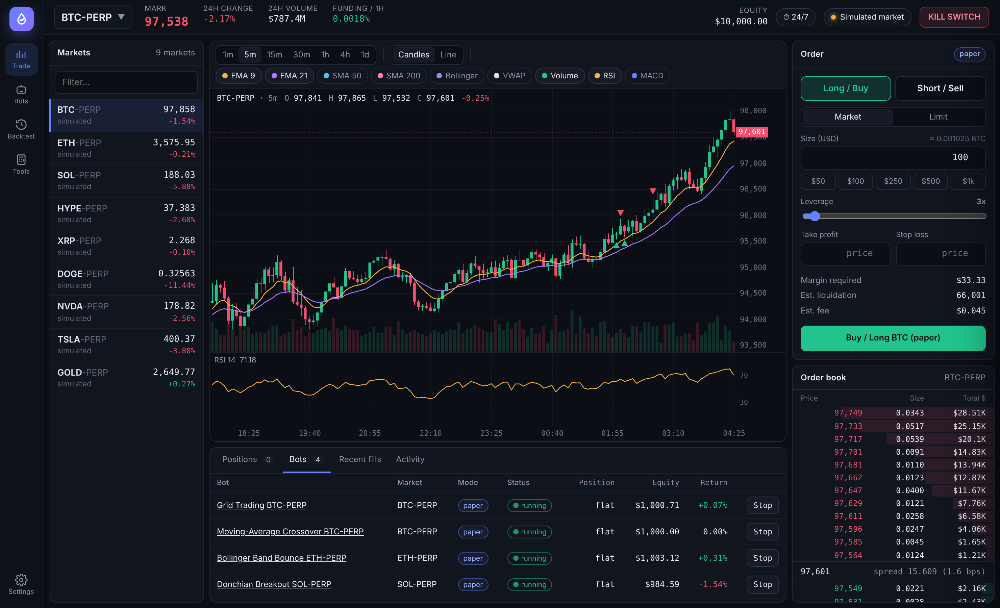

# Liquid Trader

A desktop trading app for Mac that connects to **[Liquid](https://www.liquid.trade)** (perpetual futures routed to Hyperliquid and other venues). It has built-in trading bots, a backtester, pro charts, and trading tools, and it can run 24/7 in the background.



## Features

| | |
|---|---|
| **Trade** | Candlestick and line charts with EMA, SMA, Bollinger, VWAP, Volume, RSI and MACD. Zoom with the scroll wheel, drag to pan, double-click to reset. Also: live order book, watchlist, and an order ticket with leverage, TP/SL, margin, estimated liquidation and fees. |
| **Bots** | 6 built-in strategies, each bot in paper or live mode. Per-bot equity curves, trade markers on the chart, logs, and stop-loss / take-profit / max-drawdown limits. |
| **Backtest** | Replay any strategy on historical candles. You get return, buy-and-hold comparison, max drawdown, win rate, profit factor, Sharpe, an equity curve, and trades plotted on price. Deploy the result as a bot in one click. |
| **Tools** | Position-size (risk-based), liquidation price, P&L/target, risk/reward + expectancy, funding cost, grid planner, compounding. |
| **24/7** | A background service keeps trading when the window is closed. It starts at login, restarts itself after a crash, prevents idle sleep, resumes your bots after restarts, and reconnects to Liquid after outages. |
| **Safety** | Paper mode is the default, and simulated-market mode needs no API key. Live orders need confirmation, and live bots need you to type `LIVE`. Also: a global kill switch, max order size, a max total live exposure limit, and the API key stored in the macOS Keychain. |

### Built-in strategies

| Strategy | Idea | Best in |
|---|---|---|
| **Grid Trading** | Buys a lot each time price falls through a grid level and sells it one level higher | Sideways / ranging markets |
| **Moving-Average Crossover** | Goes long on a fast/slow EMA or SMA golden cross, exits (or flips short) on the death cross | Trending markets |
| **RSI Mean Reversion** | Scales into oversold dips, exits when overbought (long only) | Choppy markets with pullbacks |
| **Bollinger Band Bounce** | Buys closes below the lower band and exits at the middle band, optionally shorts the upper band | Range-bound, mean-reverting markets |
| **Donchian Breakout** | Turtle-style: enters on an N-bar high/low breakout, exits on the opposite M-bar channel | Strong breakouts |
| **Smart DCA** | Buys a fixed amount every N bars, and a multiple of it when price is X% below your average | Long-term accumulation |

## Install on your Mac

You need macOS 11+ and Python 3.9+. macOS already has Python 3.9 if Xcode Command Line Tools are installed (`xcode-select --install`). Otherwise get it from python.org or Homebrew.

```bash
git clone -b claude/liquid-trader-mac https://github.com/swharesh-cloud/REA.git
cd REA/liquid-trader
./build_mac_app.sh --install
open "/Applications/Liquid Trader.app"
```

The first launch takes about 30 seconds. It creates a private Python environment under `~/Library/Application Support/LiquidTrader` and installs `pywebview` for the native window. The app is ad-hoc signed, not notarized, so the first time you open it, **right-click → Open**.

If you'd rather not build an app, double-click `run.command`, or run `python3 -m liquid_trader`. Without `pywebview` installed, it opens in your browser.

## Connect your Liquid account

1. Create an API key and secret at **https://sdk.tryliquid.xyz**.
2. In the app, go to **Settings → Liquid connection**, paste them in, and click **Save & connect**. The key is stored in your macOS Keychain.
3. Data now comes from Liquid. Run bots in **Paper** mode first: real Liquid prices with simulated fills. Switch a bot to **Live** only once you're happy with it.

Until you add a key, the app runs on a realistic **simulated market** so you can learn the app and test strategies safely. The simulated market runs fast, so bots trade visibly.

## Run 24/7

**Settings → 24/7 trading → Turn on 24/7 service** installs a `launchd` agent (`~/Library/LaunchAgents/com.liquidtrader.engine.plist`). The agent:

- runs the trading engine in the background with no window (`--headless`), wrapped in `caffeinate -i -s` so the Mac doesn't idle-sleep,
- starts at login and is restarted by macOS if it ever exits or crashes (`KeepAlive`),
- resumes every bot that was running, and keeps re-testing the Liquid connection (bots keep their state across restarts),
- lets you close the app window. Reopening the app reconnects to the running engine.

Only one engine can trade at a time. A lock file ensures that, so a second copy never double-trades your bots.

From Terminal: `python3 -m liquid_trader --install-service` / `--uninstall-service`. Logs: `~/Library/Logs/LiquidTrader.log`. If you move the app after turning the service on, turn it off and on again.

> **The Mac has to stay on and online.** The service stops *idle* sleep, but closing a laptop lid still sleeps the Mac unless it's on power with an external display. For guaranteed uptime, run the engine on a small always-on Linux server or VPS:
>
> ```ini
> # /etc/systemd/system/liquid-trader.service
> [Unit]
> Description=Liquid Trader engine
> After=network-online.target
>
> [Service]
> User=trader
> WorkingDirectory=/opt/REA/liquid-trader
> ExecStart=/usr/bin/python3 -m liquid_trader --headless --port 8765
> Environment=LIQUID_API_KEY=... LIQUID_API_SECRET=...
> Restart=always
> RestartSec=5
>
> [Install]
> WantedBy=multi-user.target
> ```
>
> The server only listens on `127.0.0.1`. Reach the dashboard from your Mac with an SSH tunnel: `ssh -L 8765:127.0.0.1:8765 you@server`, then open http://127.0.0.1:8765.

## How it works

```
liquid_trader/
  api.py          Liquid REST client (HMAC-SHA256 request signing)
  market.py       Market data: LiquidMarket (live, cached) and SimMarket (offline demo)
  strategies.py   The 6 strategies; add your own by subclassing Strategy
  engine.py       Bot accounting, risk clamps, paper/live executors, backtester, 24/7 loop
  server.py       Local JSON API + dashboard (127.0.0.1 only, per-launch token, Host check)
  service.py      Single-instance lock and the macOS launchd service
  credentials.py  Keychain / env var / 0600 file storage for API keys
  static/         Dashboard UI and a dependency-free canvas charting library
```

- **No third-party dependencies.** The engine is pure Python standard library. `pywebview` is optional and only provides the native window.
- **Sizes are USD notional**, matching Liquid's API. The engine clamps every opening order to the bot's budget × leverage and to your max-order limit, and rejects orders under $10.
- Bar-based strategies only act when a candle **closes**, so live behavior matches backtests.
- Paper fills assume a 0.045% taker fee and 0.02% slippage.
- Live bots keep their own position ledger from their fills. They use market orders, and closes are sent as the opposite side for the bot's exact size.
- Network errors and 5xx/429 responses are retried on the next tick and never stop a live bot. 5 consecutive order rejections (4xx) stop it.

### Adding a strategy

```python
class MyStrategy(Strategy):
    key, label = "mine", "My strategy"
    description = "What it does"
    params = [P("period", "Period", "int", 20, min=2)]

    def on_tick(self, ctx):
        if not ctx.new_bar():
            return
        if ctx.closes[-1] > max(ctx.closes[-self.p["period"]:-1]):
            ctx.target_usd(ctx.max_notional, "new high")
        elif ctx.position and ctx.closes[-1] < ctx.entry * 0.97:
            ctx.close("down 3%")
```

Register it in `STRATEGIES` at the bottom of `strategies.py`. It shows up automatically in the bot builder and the backtester.

## Tests

```bash
python3 -m unittest discover -s tests -v
```

The tests cover request signing (checked byte-for-byte against the JavaScript reference client when `node` is available), indicators, position accounting, every strategy, risk clamps, the HTTP API with its auth checks, bot auto-resume, the kill switch, and the single-instance lock.

## Important notes

- Liquid's official programmatic surface is its Co-Invest MCP server. This app uses Liquid's REST API at `api-public.liquidmax.xyz/v1`, with the signing scheme and endpoints documented by the community [Liquid-trading](https://github.com/garavels/Liquid-trading) client. The first time you connect, start with **paper bots and a tiny live order** to confirm everything behaves as expected on your account.
- The liquidation price shown is an isolated-margin estimate. Liquid/Hyperliquid's real value depends on your margin mode and account.
- Trading leveraged perpetual futures is risky, and you can lose more than you expect. Backtests and paper results don't guarantee live results. Use the risk limits and the kill switch.
